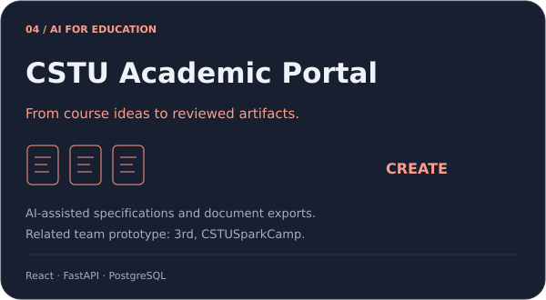
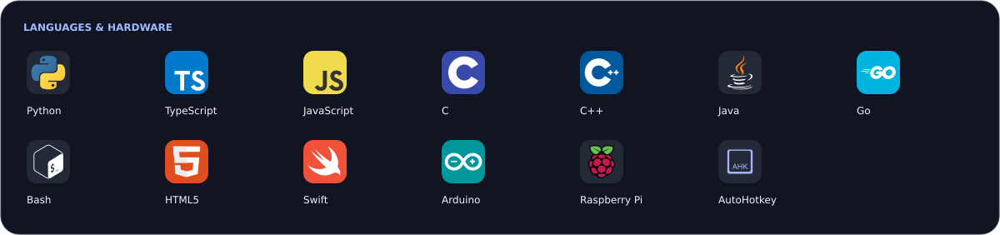
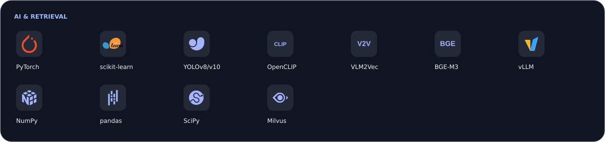
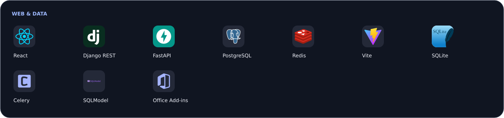
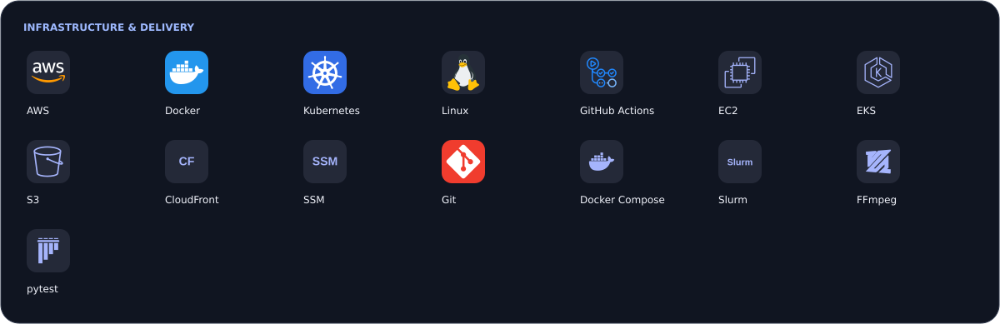

<a href="#selected-work">Selected work</a> &nbsp; / &nbsp; <a href="#research">Research</a> &nbsp; / &nbsp; <a href="#toolbox">Toolbox</a>

  
  

I'm **Rojsak Kritsuthikul (Gear)**, a CS undergraduate at **Thammasat University** (GPA 3.85). I build research software for applied AI, video retrieval, and LLM infrastructure.

**Currently** · Undergraduate Student Researcher, TONKIT Lab · Oct 2025–Present 
**Previously** · NECTEC research intern · Apr–May 2024 
**Community** · Teaching mathematics and programming for Computer Olympiad preparation

## Selected work

**Also built & explored**

- **LLM infrastructure** — vLLM keep-alive configuration contribution, Thai streaming benchmarks, and GPU serving on Amazon EKS.
- **HeartCheck** — Team lead and web developer for a CNN heart-sound prototype; IID 2024 Silver Medal.
- **Cervical cell screening** — YOLOv8/v10 evaluation; reported 0.86 mAP50 for binary screening and a PRAGMA 41 collaboration award.
- **ThaiMCQ4Word** — NECTEC internship contribution using Word APIs and document analysis for Thai exam rearrangement.

## Research

**First author · Submitted manuscript** 
[What Autoscaling Signals Miss: Characterizing Completed-Throughput and Waiting-Queue Scaling for LLM Serving](https://github.com/GearJP2/CENTRA10/blob/main/docs/paper/README.md)

**Co-author · Accepted · Upcoming presenter** 
[Semantic Video Chunking with Video-LLM Reranking for the NTCIR-19 Lifelog-7 CSAT Task](https://github.com/GearJP2/NTCIR_19_Proceedings_LLFL26). Presenting at the National Institute of Informatics (NII), Tokyo, Japan.

**Poster presenter · CENTRA 9** 
Presented existing research on migrating deep learning workloads across Kubernetes edge nodes.

## Along the way

| 2026 | Recognition |
| :--- | :--- |
| July | **3rd Place** · CSTUSparkCamp |
| May | **Finalist** · NTU Hackathon, Singapore—sensor-controlled rehabilitation game |
| March | **NSTC IIPP funded selection** · Declined due to degree-schedule overlap |

**PRAGMA 41** · Outstanding Performance Cross-Cultural Collaboration Award 
**IID 2024** · Silver Medal for HeartCheck

## Toolbox

Specialist tools without a verified logo use labeled monograms.

---

Built with curiosity. Backed by evidence.

