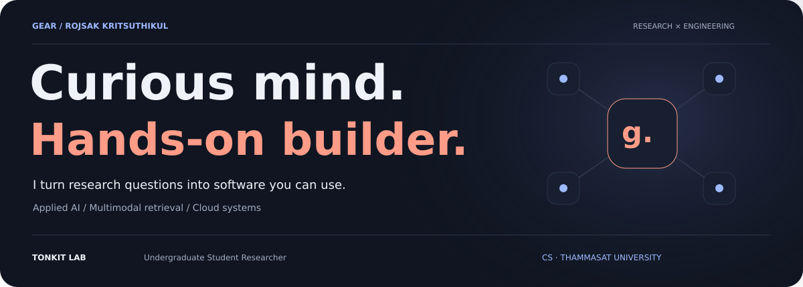
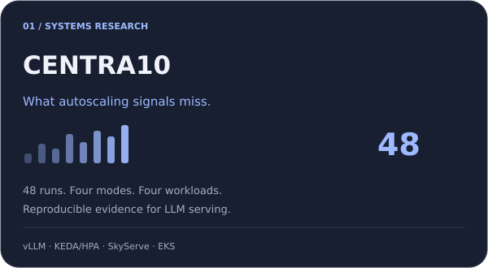
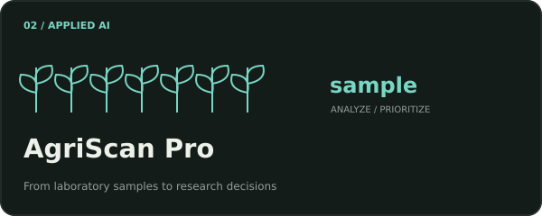
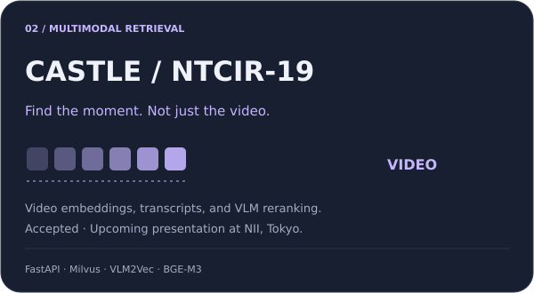

  

  <a href="#selected-work">Explore the work</a> &nbsp; ↗ &nbsp;
  <a href="#research">Read the research</a> &nbsp; ↗ &nbsp;
  <a href="#toolbox">Open the toolbox</a>

  
  

---

I’m **Gear**, a Computer Science undergraduate building at the intersection of **AI research and software engineering**. My work spans semantic video search, agricultural research platforms, and reproducible LLM serving experiments.

**Now** · TONKIT Lab, since Oct 2025 &nbsp; **Previously** · NECTEC research intern, Apr–May 2024  
**Beyond code** · Teaching mathematics and programming for Computer Olympiad preparation  
**Education** · Computer Science, Thammasat University · GPA 3.85

## Selected work

Research questions, working software, and the evidence behind them.

<table>
<tr>
<td width="50%" valign="top">

<h3>01 / <a href="https://github.com/GearJP2/CENTRA10">CENTRA10</a></h3>

LLM SERVING · SYSTEMS RESEARCH

What do autoscaling signals miss? A <b>48-run study</b> of latency, SLO attainment, and GPU allocation across four serving modes and four workloads.

vLLM · KEDA/HPA · SkyServe · Prometheus · EKS

<a href="https://github.com/GearJP2/CENTRA10/blob/main/docs/paper/README.md">Manuscript & reproducible evidence ↗</a>
</td>
<td width="50%" valign="top">

<h3>02 / <a href="https://github.com/GearJP2/agriscan-pro">AgriScan Pro</a></h3>

FULL-STACK · APPLIED ML

Agricultural sample management, contamination analytics, and ML-assisted sampling priorities in one research platform.

React · Django REST · PostgreSQL · AWS

</td>
</tr>
<tr>
<td width="50%" valign="top">

<h3>03 / <a href="https://github.com/GearJP2/NTCIR_19_Proceedings_LLFL26">CASTLE Semantic Retrieval</a></h3>

MULTIMODAL SEARCH · LIFELOG VIDEO

Team LifeLogForLife research connecting video embeddings, transcripts, and vision-language reranking to timestamped video results.

FastAPI · Milvus · VLM2Vec · BGE-M3

</td>
<td width="50%" valign="top">

<h3>04 / CSTU Academic Portal</h3>

AI WORKFLOWS · EDUCATION

AI-assisted course specifications, learning-outcome mapping, and document exports. Related LMS-to-OBE team prototype: <b>3rd Place, CSTUSparkCamp</b>.

React · FastAPI · PostgreSQL

</td>
</tr>
</table>

**Also built & explored**

- **LLM infrastructure** — vLLM keep-alive configuration contribution, Thai streaming benchmarks, and GPU serving on Amazon EKS.
- **HeartCheck** — Team lead and web developer for a CNN heart-sound prototype; IID 2024 Silver Medal.
- **Cervical cell screening** — YOLOv8/v10 evaluation; reported 0.86 mAP50 for binary screening and a PRAGMA 41 collaboration award.
- **ThaiMCQ4Word** — NECTEC internship contribution using Word APIs and document analysis for Thai exam rearrangement.

## Research

**First author · Submitted manuscript**  
[What Autoscaling Signals Miss: Characterizing Completed-Throughput and Waiting-Queue Scaling for LLM Serving](https://github.com/GearJP2/CENTRA10/blob/main/docs/paper/README.md)

**Co-author · Accepted · Upcoming presenter**  
[Semantic Video Chunking with Video-LLM Reranking for the NTCIR-19 Lifelog-7 CSAT Task](https://github.com/GearJP2/NTCIR_19_Proceedings_LLFL26). Presenting at the National Institute of Informatics (NII), Tokyo, Japan.

**Poster presenter · CENTRA 9**  
Presented existing research on migrating deep learning workloads across Kubernetes edge nodes.

## Along the way

| 2026 | Recognition |
| :--- | :--- |
| July | **3rd Place** · CSTUSparkCamp |
| May | **Finalist** · NTU Hackathon, Singapore—sensor-controlled rehabilitation game |
| March | **NSTC IIPP funded selection** · Declined due to degree-schedule overlap |

**PRAGMA 41** · Outstanding Performance Cross-Cultural Collaboration Award  
**IID 2024** · Silver Medal for HeartCheck

## Toolbox

The tools behind the experiments, interfaces, and infrastructure.

#### Languages & hardware

<table>
<tr>
<td align="center" width="96"> Python</td>
<td align="center" width="96"> TypeScript</td>
<td align="center" width="96"> JavaScript</td>
<td align="center" width="96"> C</td>
<td align="center" width="96"> C++</td>
<td align="center" width="96"> Java</td>
<td align="center" width="96"> Go</td>
</tr>
<tr>
<td align="center" width="96"> Bash</td>
<td align="center" width="96"> HTML5</td>
<td align="center" width="96"> Swift</td>
<td align="center" width="96"> Arduino</td>
<td align="center" width="96"> Raspberry Pi</td>
<td align="center" width="96"> AutoHotkey</td>
</tr>
</table>

#### AI & retrieval

<table>
<tr>
<td align="center" width="96"> PyTorch</td>
<td align="center" width="96"> scikit-learn</td>
<td align="center" width="96"> YOLOv8/v10</td>
<td align="center" width="96"> OpenCLIP</td>
<td align="center" width="96"> VLM2Vec</td>
<td align="center" width="96"> BGE-M3</td>
<td align="center" width="96"> vLLM</td>
</tr>
<tr>
<td align="center" width="96"> NumPy</td>
<td align="center" width="96"> pandas</td>
<td align="center" width="96"> SciPy</td>
<td align="center" width="96"> Milvus</td>
</tr>
</table>

#### Web & data

<table>
<tr>
<td align="center" width="96"> React</td>
<td align="center" width="96"> Django REST</td>
<td align="center" width="96"> FastAPI</td>
<td align="center" width="96"> PostgreSQL</td>
<td align="center" width="96"> Redis</td>
<td align="center" width="96"> Vite</td>
<td align="center" width="96"> SQLite</td>
</tr>
<tr>
<td align="center" width="96"> Celery</td>
<td align="center" width="96"> SQLModel</td>
<td align="center" width="96"> Office Add-ins</td>
</tr>
</table>

#### Infrastructure & delivery

<table>
<tr>
<td align="center" width="96"> AWS</td>
<td align="center" width="96"> Docker</td>
<td align="center" width="96"> Kubernetes</td>
<td align="center" width="96"> Linux</td>
<td align="center" width="96"> Actions</td>
</tr>
</table>

**AWS Services**

<table>
<tr>
<td align="center" width="96"> EC2</td>
<td align="center" width="96"> EKS</td>
<td align="center" width="96"> S3</td>
<td align="center" width="96"> CloudFront</td>
<td align="center" width="96"> SSM</td>
</tr>
</table>

**Tooling**

<table>
<tr>
<td align="center" width="96"> Git</td>
<td align="center" width="96"> Docker Compose</td>
<td align="center" width="96"> Slurm</td>
<td align="center" width="96"> FFmpeg</td>
<td align="center" width="96"> pytest</td>
</tr>
</table>

---

RESEARCH WITH CURIOSITY. BUILD WITH PURPOSE.

